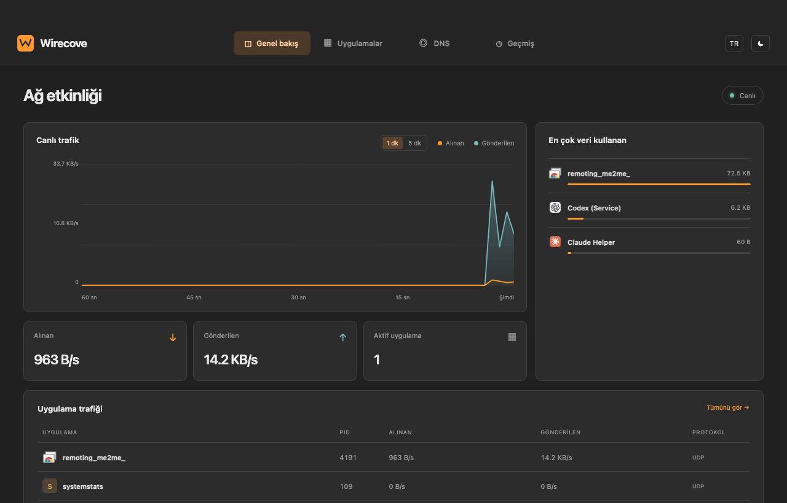
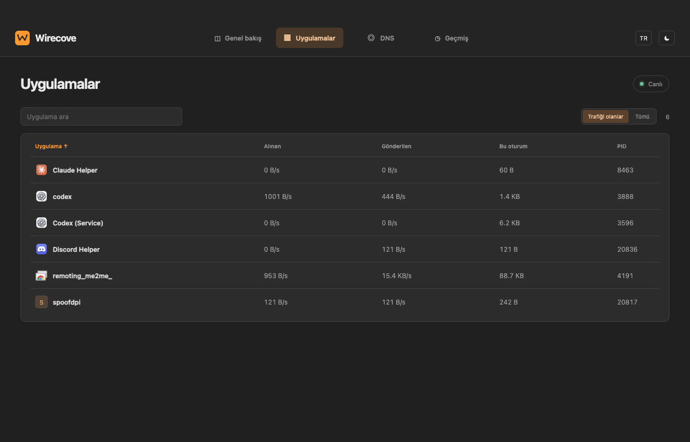

# Wirecove

Open-source desktop network control project. This is the first experimental
macOS build. It combines a shared Electron interface with a macOS `nettop`
collector. Overview shows live TCP/UDP rates, an interactive 1/5-minute graph
and the highest-usage apps. The separate
Applications page shows available app icons, search and sorting by name, live
rates or data usage since Wirecove started. It keeps processes seen during the
current session, filters to those with traffic by default, and opens a compact
per-process usage panel when a row is selected.
The DNS page reads effective macOS resolver and system proxy status without
changing either. Implementation stages and acceptance tests are in
[ROADMAP.md](ROADMAP.md).
History records observed process-to-remote-IP TCP/UDP connections in a local
SQLite database under Wirecove's application data folder. It retains at most
7 days or 10,000 connections and has a clear button. A target can be tested
for DNS resolution, direct TCP connectivity and, for HTTPS domain names, TLS.
The test does not prove that a full web page or application works.
The chosen order stays fixed while live rates update; click a column again to
refresh its order.
The monitoring, history, diagnosis and DNS status views are read-only. The DPI
controls activate or remove the local macOS transparent proxy configuration.





## Run on macOS

Requires macOS, Node.js/npm and Python 3. The current collector needs a working
`python3` at `/usr/local/bin/python3`, `/opt/homebrew/bin/python3` or
`/usr/bin/python3`. To specify another Python, set `WIRECOVE_PYTHON`.

```sh
npm install
npm start
```

On this Mac, the single launch command is:

```sh
cd ~/Desktop/Wirecove && npm start
```

The UI has Turkish and
English labels and a dark/light switch. The dark palette uses charcoal panels
with an orange accent. Traffic values are actual `nettop` observations, not demo
data. Initial process samples and restarted counters are excluded from rates.

## Verify

```sh
node --check src/main.js
node --check src/preload.js
node --check src/renderer.js
node --test tests/dns.test.js
node --test tests/dpi.test.js
PYTHONPATH=native python3 -m unittest discover -s tests -v
npm run smoke
./node_modules/.bin/electron . --route-list-smoke
```

`npm run smoke` saves `smoke.png` after opening the desktop window. It is ignored
by Git. For controlled TCP/UDP tests, run the existing independent prototype's
`python3 validate.py tcp` and `python3 validate.py udp` from its folder.

## Scope

The DPI page has site and application lists. Adding a site or signed application
updates one macOS transparent proxy rule and turns DPI on. Removing an item
updates that rule; **Turn off all** pauses both lists. The app remembers this
on/off choice across launches. Saved sites open in the default browser. Discord
is no longer a special UI row; it can be selected like another installed app.
The website test form still compares direct and DPI-assisted HTTP(S) requests.

The native proxy routes selected TCP web flows on ports 80/443 to the local
SpoofDPI listener; unselected flows proceed directly. Apple reports the source
app's signing identifier to the extension, which is matched against selected
apps. Flows addressed only by IP, UDP/HTTP/3, and other ports are not covered
by this prototype. A connected rule means the route is active, not that every
site or all of its CDN/media domains will load. No system proxy or DNS setting
is changed. The bundled SpoofDPI binary is version 1.5.5 for macOS x86_64,
with its Apache-2.0 license in `native/macos/dpi/`. Automatic discovery of
alternate DPI methods is planned, not implemented.

System-level selective routing uses a macOS Network Extension
(`NETransparentProxyProvider`) and needs more routing tests. The Swift provider in `native/macos/extension/` has
an experimental HTTP CONNECT TCP bridge to the local SpoofDPI listener for
selected domains and applications on ports 80/443. The `WirecoveProxy.xcodeproj` system-extension
target and its small `WirecoveMacHost.app` build without signing for both Intel
and Apple Silicon with Xcode 16.2. The host embeds the extension at Apple's
required `Contents/Library/SystemExtensions` path. Its default command only
checks that bundle; forwarding is disabled by default. On this
custom-configured Mac, an ad-hoc signed copy in `/Applications` was approved
and activated. A selected `example.com` TCP/443 flow was claimed by the
extension, opened a local HTTP CONNECT to SpoofDPI, and returned HTTP 200.
The test removed its proxy configuration afterward. UDP and
unmatched flows stay direct. When forwarding is explicitly enabled, startup
rejects an unavailable local proxy before applying network rules.
On 2026-11-10, fresh connect attempts timed out while macOS saved the Network
Extension configuration. The app later restored its previously saved
`funpic.hu` and Discord rule, and the manager reported `connected`. The UI and
unit tests pass, but the new multi-site configuration has not passed a live
traffic test; investigate these intermittent manager timeouts before release.
Xcode is installed at `~/Downloads/Xcode.app`, while the global Command Line
Tools selection is broken. This Mac has no Apple code-signing identity; its SIP
configuration is custom. The local ad-hoc test does not establish that the
extension can run on ordinary user Macs. Application firewall,
DNS profiles/DoH, QoS and game mode are future modules.
Per-process counters are not a physical wire-speed
measurement; loopback traffic can appear at both endpoints. Short connections
between samples may be missed.

The Mac adapter is isolated in `native/netwatch.py`; the shared interface is in
`src/`. The privileged Network Extension is a separate, signed module
with explicit user consent and tested restore paths. DNS Boat remains separate.

To repeat the Swift checks on this Mac without changing the global Xcode selection:

```sh
cd ~/Desktop/Wirecove
DEVELOPER_DIR="$HOME/Downloads/Xcode.app/Contents/Developer" xcrun swiftc -target x86_64-apple-macosx14.0 -typecheck native/macos/extension/SitePolicy.swift native/macos/extension/HTTPConnect.swift native/macos/extension/TCPConnectBridge.swift native/macos/extension/WirecoveTransparentProxyProvider.swift
DEVELOPER_DIR="$HOME/Downloads/Xcode.app/Contents/Developer" xcrun swiftc -target x86_64-apple-macosx14.0 native/macos/extension/SitePolicy.swift native/macos/extension/HTTPConnect.swift native/macos/extension/PolicyCheck.swift -o /tmp/wirecove-policy-check && /tmp/wirecove-policy-check
DEVELOPER_DIR="$HOME/Downloads/Xcode.app/Contents/Developer" xcodebuild -quiet -project native/macos/extension/WirecoveProxy.xcodeproj -target WirecoveProxy -configuration Debug SYMROOT=/tmp/wirecove-build CODE_SIGNING_ALLOWED=NO build
DEVELOPER_DIR="$HOME/Downloads/Xcode.app/Contents/Developer" xcrun swiftc -target x86_64-apple-macosx14.0 native/macos/extension/LocalProxyProbe.swift native/macos/extension/ProbeCheck.swift -o /tmp/wirecove-probe-check && /tmp/wirecove-probe-check 18089
DEVELOPER_DIR="$HOME/Downloads/Xcode.app/Contents/Developer" xcodebuild -quiet -project native/macos/extension/WirecoveProxy.xcodeproj -target WirecoveMacHost -configuration Debug SYMROOT=/tmp/wirecove-build CODE_SIGNING_ALLOWED=NO build
/tmp/wirecove-build/Debug/WirecoveMacHost.app/Contents/MacOS/WirecoveMacHost
```

### macOS signing

Xcode can compile this test bundle unsigned. On this custom-configured test Mac,
an ad-hoc signature passed validation and the user approved the extension.
The selected TCP flow test passed; this does not establish that an ad-hoc
extension can run on ordinary user Macs. For ordinary signed testing and
distribution, add an Apple Developer Program team in Xcode, enable the System
Extension capability on the host and the App Proxy Network Extension capability
for both targets, and create or let Xcode manage the matching certificates and
provisioning profiles.
The bundle identifiers in this prototype are placeholders; configure real App
IDs for the team's namespace before signing. For distribution outside the Mac
App Store, use Developer ID Application signing and the corresponding
`app-proxy-provider-systemextension` entitlement/profile, then notarize the app.
The native development harness has explicit `inspect`, `activate`, `status`,
`connect DOMAIN...`, and `disconnect` commands. Electron calls connect and
disconnect when the user changes the DPI lists or toggle.
`native/macos/host/test-live.sh` contains a selected-domain test
with automatic disconnect on exit. It forces TCP/HTTP-1.1 requests to a
selected and an unselected domain, requires HTTP 200 for both, and verifies
that only the selected flow reaches the extension and establishes CONNECT.
On this Mac run:

```sh
cd ~/Desktop/Wirecove && bash native/macos/host/test-live.sh
```

The test does not validate UDP/HTTP/3, browser use, blocked sites, or
application-specific routing. The activated extension stays installed, while
the test's transparent proxy configuration is removed on exit.

## GitHub

The local Git repository uses `main`. MIT license, `.gitignore` and a CI workflow
are included. No GitHub remote has been set yet. Once the owner and repository
are chosen, create a public GitHub repository named `wirecove` and push `main`.
